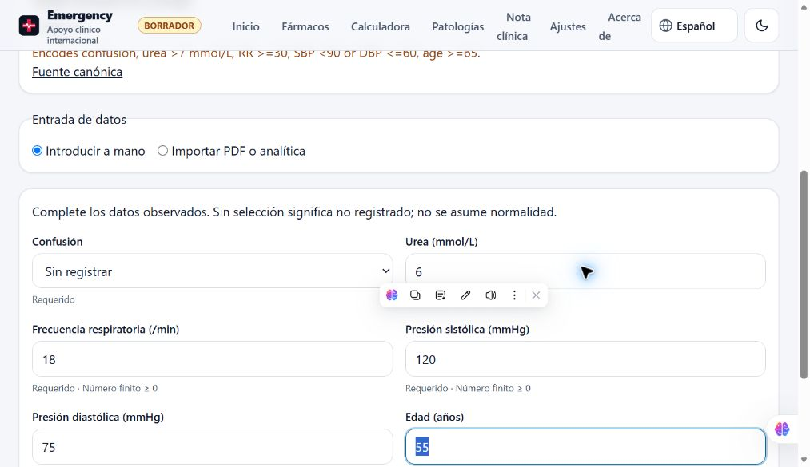

# Fragmentos de Narrador · PR61

Estado **CLINICALLY_PENDING**. Cotejo de escucha pendiente.

Cada fragmento conserva las muestras PCM del intervalo indicado de CURB65-Narrador-toma2.wav, mono a 16 kHz. Los cortes incluyen la locución y un margen de silencio. La toma de edad incluye al final el aviso de salida de Narrador.

En pantalla, los cinco campos muestran **Requerido · Número finito ≥ 0**. Para el signo ≥, el sentido esperado es «mayor o igual que cero». Cotejar cada unidad y cifra con la captura, y registrar lo que se oye literalmente.

| Fragmento | Intervalo en original | Campo | Unidad en pantalla | Valor |
|---|---|---|---|---|
| [Urea](01-urea.wav) | 3.3–12.3 s | Urea | mmol/L | 6 |
| [Frecuencia respiratoria](02-frecuencia-respiratoria.wav) | 22.7–34.5 s | Frecuencia respiratoria | /min | 18 |
| [Presión sistólica](03-presion-sistolica.wav) | 38.7–51.5 s | Presión sistólica | mmHg | 120 |
| [Presión diastólica](04-presion-diastolica.wav) | 54.8–68.2 s | Presión diastólica | mmHg | 75 |
| [Edad](05-edad.wav) | 70.9–84.0 s | Edad | años | 55 |

La captura recorta la ayuda situada bajo edad. El árbol de accesibilidad observado en la prueba registra «Edad (años) Requerido · Número finito ≥ 0».

Las transcripciones automáticas previas contienen discrepancias en unidades y comparador. La escucha de estos fragmentos permite comprobarlas. El resultado humano permanece pendiente.

Conservados por SHA-256 todos los archivos previos de esta carpeta y los 95 ZIP del registro R5. El manifiesto contiene las huellas de origen y de los cinco fragmentos.
