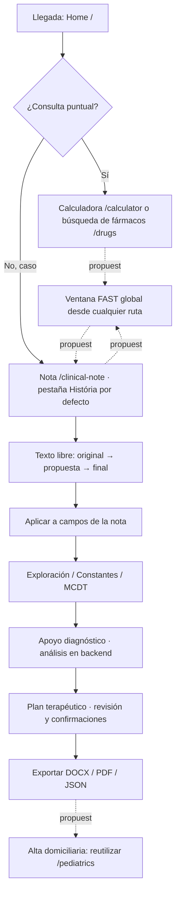

# GMFC-UX · Fase A · Revisión independiente (Claude Code, director de UX)

**Estado:** REVISIÓN INDIVIDUAL, LECTURA ESTÁTICA. No consolida en nombre de Work, no declara la guía aceptada y no añade dictámenes clínicos.
**Fuente:** PR142 `ecacffee5cdd67992e01e3913e8a0682b3b96ca3`. Las rutas y líneas corresponden al árbol de trabajo leído en el cwd.
**Estado de control:** CLINICALLY_PENDING · NOT_FROZEN_NOT_VALIDATED · NO_GO_CLINICAL_RELEASE.
**Límites:** no ejecuté git, tests, Playwright ni la UI. No verifiqué SHA/blobs con git. No usé el MCP Emergency, que no está en mis herramientas. No leí contratos clínicos completos ni expedientes restringidos. No leí entregas de otros agentes. Las cifras de contratos (19) y fórmulas (45) se preservan tal como las indica el encargo; no las he recontado.

---

## 1. Recorrido de guardia (estado actual frente a propuesto)



| Fase | Hoy (existente) | Propuesto | Fricción observada |
|---|---|---|---|
| Entrada | Home con atajos (`Home.tsx:43-50`) y búsqueda que solo lleva a `/drugs` (`Home.tsx:39`) | Ventana FAST accesible desde cualquier pantalla | Sin consulta universal; cada duda requiere cambiar de ruta |
| Consulta de cálculo | `/calculator` con parámetros `weight` y `dose` (`Calculator.tsx:54-56`) | FAST que rellena los mismos campos del motor | Reutilizable sin motor nuevo |
| Nota | Pestaña `history` por defecto (`draft.tsx:37`) | Entrada en texto libre si el borrador está vacío (decisión UX) | El médico no ve primero el texto libre |
| Documentación | Texto libre + export DOCX/PDF/JSON (`ClinicalNote.tsx:634-641`) | Copia de texto plano, impresión y formatos de nota | Faltan copia institucional, impresión y tipos de nota |
| Tratamiento | Panel de 5 secciones con validación (`therapeuticReview.ts:3`, `TherapeuticPlanPanel.tsx:54-63`) | Sin cambio funcional; mejorar resumen de confirmaciones | Existente y alineado con E3 |
| Alta | Sin flujo propio en nota; existe `PediatricOutpatient` con exportación y print (`PediatricExport.tsx:33`) | Reutilizar y separar informe profesional de instrucciones al paciente | Contenido de alta por verificar con GMFC-CLIN |

---

## 2. Mapa de navegación

```mermaid
flowchart LR
  subgraph Actual
    H[/ Home] --- DR[/drugs]
    H --- CA[/calculator]
    H --- CN[/clinical-note]
    H --- PE[/pediatrics]
    H --- SC[/scores]
    H --- GU[/guides]
    H --- CL[/clinical]
    H --- CO[/corticosteroids]
    H --- IN[/insulin-uci]
    H --- BG[/blood-gas]
    H --- T6[/t06-lab]
    CN --- TABS[8 pestañas: Texto libre·História·Exame·MCDT·Problemas·Apoio·Plano·Exportar]
  end
  subgraph Propuesto
    FAST[Ventana FAST global] -.-> CA
    FAST -.-> DR
    FAST -.-> CN
    MG[Mi guardia · episodios en memoria] -.-> CN
  end
```

**Hallazgos de navegación:**
- La barra móvil tiene 5 elementos y oculta `clinical` solo en escritorio (`Layout.tsx:13-21`, `93-113`). Procedimientos, pediatría y guías se alcanzan desde Home, no desde la barra.
- La nota tiene 8 pestañas en scroll horizontal (`ClinicalNote.tsx:64-67`, `673-675`). Los objetivos de 44 px se cumplen (`min-h-[44px]`).
- No existe ruta `/mi-guardia` ni selector de episodios (búsqueda sin coincidencias en `app/src`).

---

## 3. Layouts conceptuales (sin implementación)

**3.1 Ventana FAST (propuesta, superposición accesible)**
```
┌──────────────────────────────────────────────────────────┐
│ Consulta rápida                      [Texto] [Voz: N/D]  │
│ ┌──────────────────────────────────────────────────────┐ │
│ │ 80 años, 80 kg, perfusión de noradrenalina           │ │  ← entrada, editable
│ └──────────────────────────────────────────────────────┘ │
│ Datos detectados: edad 80 a · peso 80 kg · fármaco ✔     │  ← confirmables
│ Faltan para calcular: dosis objetivo · unidad            │  ← solo imprescindibles
│ ───────────────── Resultado ─────────────────────────────  │
│ [Bloqueo o cifra según contrato] · fuente · versión      │
│ [Abrir ficha]   [Copiar]                      [Cerrar Esc]│
└──────────────────────────────────────────────────────────┘
```
Reglas: el resultado aparece antes que las advertencias secundarias. No se muestra cifra si falta un dato crítico. Esc cierra y devuelve el foco. El texto de nota no se pierde al cerrar.

**3.2 Nota (propuesta sobre el editor existente)**
```
┌ Original (sin edición de la app) ┐┌ Propuesta por encabezados ┐
│ texto pegado / dictado manual    ││ ☑ Motivo → Motivo          │
│                                  ││ ☑ Exploración → Exploración│
└──────────────────────────────────┘└────────────────────────────┘
┌ Documento final editable (copia) ─────────────────────────────┐
│ Aviso: "Esta copia no entra en PDF/DOCX" (o incluirla, decisión §18) │
└───────────────────────────────────────────────────────────────┘
[Aplicar a campos] [Copiar texto plano] [Exportar revisado] [Imprimir]
```

**3.3 Mi guardia (fase 1, solo memoria)**
```
Episodios abiertos (memoria):
 ● A · 80 a · alias «Box 3»      [activo]
 ○ B · 7 kg · alias «Box 5»      [cambiar]
Cada episodio conserva su propio: medicación, peso, adjuntos, alertas.
```

---

## 4. Diferencias existente / propuesto

| Requisito | Existente | Propuesto | Estado |
|---|---|---|---|
| FAST universal | Solo búsqueda de fármacos (`Home.tsx:63-90`) | Ventana global | AUSENTE |
| FAST con motor | Calculadora con URL (`Calculator.tsx:54-56`); `doseToRate`/`rateToDose` (`infusion.ts:153`, `225`) | Reutilizar | PARCIAL |
| Voz | Sin API en `app/src` | Condicional | NO DISPONIBLE |
| Texto libre | Original/propuesta/final, aplicar sin sobrescribir (`FreeTextWorkspace.tsx:27-99`, `textStructuring.ts:139-161`) | Sin cambio | EXISTENTE |
| Copia institucional | Solo portapapeles del texto final (`FreeTextWorkspace.tsx:78-85`) | Texto plano de la versión revisada | PARCIAL |
| Impresión de nota | Sin `window.print` en `ClinicalNote.tsx`; existe en `AcuteMedications.tsx:129`, `ClinicalLibrary.tsx:94` | Reutilizar patrón | PENDIENTE |
| Tipos de nota | Sin selector | Plantillas (ingreso, alta, interconsulta…) | PENDIENTE |
| Tratamiento 5 secciones | `therapeuticReview.ts:3` | Sin cambio | EXISTENTE |
| Alta domiciliaria | Sin flujo en nota; pediatría ambulatoria existe | Reutilizar | PARCIAL |
| Importación | Upload y prototipo (`ClinicalNote.tsx:548-552`) | Original visible o no retenido (decisión) | PARCIAL |
| Multi-episodio | Un borrador en memoria (`draft.tsx:60-69`) | Lista en memoria | PARCIAL |
| Portada | Opt-in `?design=clinical-minimal` (`Home.tsx:17`) | Decisión del propietario | OPT-IN |

---

## 5. Consulta urgente texto / voz (condicional)

- **Texto:** primera vía. Entrada con datos detectados editables. Usa los motores existentes y no genera texto de dosis.
- **Voz:** solo si existe una capacidad técnica autorizada. Hoy no hay API de reconocimiento en `app/src`. Recomendación: no mostrar un botón de micrófono deshabilitado; mostrar «Voz no disponible en esta instalación» solo en Ajustes.
- **Si se habilita voz:** cada número, unidad, decimal y negación se confirma antes de calcular. Sin audio persistido. Si hace falta proveedor remoto, depende de IMP-01 (aplazado).

---

## 6. Nota: original, propuesta, final y exportaciones actuales

| Elemento | Comportamiento actual | Evidencia |
|---|---|---|
| Original | Textarea del usuario; la app no lo reescribe | `FreeTextWorkspace.tsx:114-125` |
| Propuesta | Divide por encabezados ya escritos; aviso de texto obsoleto | `FreeTextWorkspace.tsx:53-63`, `38` |
| Aplicar | Añade a campos; no sobrescribe ni duplica | `textStructuring.ts:139-161`, `FreeTextWorkspace.tsx:87-99` |
| Final editable | Solo portapapeles; **no entra** en `buildNote` | `ClinicalNote.tsx:189` (solo escaneo de privacidad), `238-290`; `textWorkspace.locales.json:55` (lo advierte) |
| Exportación | DOCX/PDF/JSON desde campos estructurados; bloqueada sin privacidad, revisión médica, MCDT pendientes o terapia no validada | `ClinicalNote.tsx:198`, `205-209`, `505-527`, `641`; `api.ts:137` |
| Diagnóstico desactualizado | Texto dice «puede exportar si el médico acepta», pero no encuentro control de aceptación en `634-641`, y `baseExportBlocked` no incluye `diagnosticStale` | `ClinicalNote.tsx:198`, `640` |
| Invalidación | Un cambio de texto limpia la revisión terapéutica | `ClinicalNote.tsx:211-236` |
| Copia institucional | No existe | — |

---

## 7. Tratamiento y alta (solo referencial)

- **Tratamiento:** el panel expone las 5 secciones de E3 (`initial_actions`, `medications`, `monitoring`, `reassessment`, `disposition`). Distingue referencia (`TherapeuticPlanPanel.tsx:63`) de plan confirmado (`57-61`). El plan se valida solo si las 5 secciones están completas y las confirmaciones están marcadas. Falta: un resumen legible de lo confirmado. El plan usa solo fuentes del catálogo; la pauta y los contratos no cambian en esta revisión.
- **Alta:** no hay flujo propio. La opción recomendada es reutilizar pediatría ambulatoria, con exportación y print existentes (`PediatricExport.tsx:33`). Separar informe profesional de instrucciones al paciente (E4) requiere verificación de GMFC-CLIN.
- **Insulina y labetalol:** no inferir producto ni preparación. En labetalol, la selección de referencia está vacía por defecto (`IvAntihypertensiveReference.tsx:16-17`, `28-34`) y hay varios productos por país (`iv-antihypertensive-reference.json:63-106`). Mostrar «preparación no confirmada» cuando la fuente no la indique.

---

## 8. Multi-episodio seguro

- **Existente:** el borrador se reinicia por `encounter` (`draft.tsx:74-77`, `88-100`), lo que aísla los campos entre episodios. Nuevo caso vía `reset` con confirmación (`ClinicalNote.tsx:654-656`). Aviso `beforeunload` si hay contenido (`draft.tsx:63-68`).
- **Propuesto fase 1:** lista en memoria con alias no identificable; cambio explícito; cada episodio con su propia medicación, peso, adjuntos y alertas.
- **Aplazado:** persistencia. Depende de IMP-04 a IMP-08 (aplazados) y de requisitos de privacidad. No habilitar almacenamiento de datos clínicos reales.
- **Criterio:** secuencia A/B/A en casos sintéticos sin ninguna mezcla de campos (conteo = 0).

---

## 9. Importación

| Tipo | Estado | Nota |
|---|---|---|
| Analítica, gasometría, ECG, TAC, PDF, imagen | Upload existente con lista `.pdf .png .jpg .jpeg .webp .txt .csv .json .xml .dcm` (`ClinicalNote.tsx:551`); extracción en backend (`api.ts:70-94`) | Extracción real: NO VERIFICADO |
| DICOM y PDF para interpretación | Excluidos del envío (`ClinicalNote.tsx:570`) | RESTRINGIDO |
| Prototipo de entrada por modalidad | Solo con bandera `VITE_R51_PROTOTYPE` (`ClinicalNote.tsx:550`) | NO DISPONIBLE en producción |
| Original visible | Texto por defecto: «el original no se guarda» (`551`, `562`) | Conflicto con E5 «mostrar original»: decisión |
| Voz / OCR | Sin evidencia de OCR en navegador; sin voz | NO DISPONIBLE |

---

## 10. Alertas, accesibilidad, offline y responsive

- **Alertas existentes:** privacidad STOP (`ClinicalNote.tsx:648`, `670`), número inválido (`669`), error de API con `role="alert"` (`671`), exportación bloqueada con `role="status"` (`641`).
- **Falta:** taxonomía de tres niveles (crítica / precaución / actualización de guía) según E6. Deduplicar por episodio sin ocultar avisos obligatorios.
- **Accesibilidad:** enlace de salto (`Layout.tsx:36-41`), foco al cambiar de ruta (`29-32`), pestañas con `aria-current` (`ClinicalNote.tsx:674`), contraste y foco visible a verificar. `devDependencies` no incluye axe-core (`package.json:79-102`); hay scripts de accesibilidad (`check-ui-accessibility-v143.mjs`), no ejecutados.
- **Offline:** service worker con `navigateFallback` y lista de exclusión `/api` (`vite.config.ts:113-143`). Durante una actualización, las pantallas nuevas quedan bloqueadas pero se conserva la nota (`IndividualRouteGuard.tsx:37-67`, copy `8-13`). Falta indicador de conexión visible.
- **Responsive:** barra móvil de 60 px por elemento (`Layout.tsx:104`); el solape horizontal de 360 px se corrigió en la entrada por modalidad (STATE, entrada R16).

---

## 11. Portada e identidad

- **Existente:** `ClinicalMinimalIntro.tsx:6-35` con imagen `public/design/clinical-minimal-physician.svg`, alt descriptivo (`27`) y estilos aislados (`clinical-minimal.css:3`). Solo se activa con `?design=clinical-minimal` (`Home.tsx:17`, `55`).
- **Portada por defecto:** título plano (`Home.tsx:56-60`). Las herramientas están antes que la ilustración (`43-50` antes de `51`), lo que cumple «no añade pasos».
- **Marca:** `brand.ts:5-15` (acento `#e11d48`) y `Logo.tsx`. No se propone nuevo logotipo. Figma MCP y herramientas nuevas: no evaluados; no añadir dependencias.
- **Estado del coordinador:** PR139 aporta diseño previo y no se integró su portada/logos. Lo que existe en el árbol es opt-in, coherente con ese límite.

---

## 12. Estados de interfaz

| Estado | Dónde existe hoy | Recomendación |
|---|---|---|
| Vacío | Propuesta vacía (`FreeTextWorkspace.tsx:140`); plan vacío (`TherapeuticPlanPanel.tsx:50`) | Mantener, con siguiente paso accionable |
| Carga | Fallback `…` (`App.tsx:28`); «preparando» en terapia (`TherapeuticPlanPanel` `c.preparing`) | Indicar qué se está calculando; sin temporizadores |
| Error | `role="alert"` (`ClinicalNote.tsx:671`); límite de ruta (`IndividualRouteGuard.tsx:18-22`) | Conservar nota y ofrecer volver |
| Restringido | Bloqueo por privacidad (`648`, `670`); exportación bloqueada (`641`); PDF/DICOM excluidos (`570`) | Motivo y acción concreta |
| No disponible | Catálogo de terapia (`TherapeuticPlanPanel.tsx:45`); backend indisponible (`ClinicalNote.tsx:500`); voz y print de nota ausentes | Texto explícito y alternativa manual |

---

## 13. Casos sintéticos (comportamiento esperado, sin dosis)

| # | Caso | Comportamiento esperado | Hallazgo de partida |
|---|---|---|---|
| S1 | «80 años, 80 kg, noradrenalina» | Pide dosis objetivo y unidad; no calcula sin ellas; preparación solo de la ficha confirmada | Fármaco presente en `drugs.json` (`norepinephrine`, línea 86) |
| S2 | «Niño 35 kg, hidrocortisona IV» | Enruta a corticoides con edad/peso; sin cifra ante dato faltante | Presente en `catalog.generated.json` y pediatría; ausente como id en `drugs.json` (búsqueda) |
| S3 | «Adrenalina en anafilaxia» | Referencia de guía; sin dosis por defecto | Guía `anaphylaxis` (`generatedClinicalGuides.json:283`) |
| S4 | «Gasometría» | Abre `/blood-gas`; no interpreta diagnósticamente | Ruta existente |
| S5 | «Cardioversión» | Referencia de procedimiento | Presente en `clinical/modules` |
| S6 | «Antídotos» | Abstención si no hay contenido canónico verificado | NO VERIFICADO en app |
| S7 | Labetalol IV | Sin producto preseleccionado; preparación no confirmada | `iv-antihypertensive-reference.json` |
| S8 | Insulina | Sin producto ni preparación inferidos | `/insulin-uci` |
| S9 | Niño 7 kg, otitis | Alta referencial; sin antibiótico inferido; separa instrucciones | `/pediatrics` |
| S10 | Caso A → B → A | Cero mezcla de campos | `draft.tsx:74-77` |

---

## 14. Criterios medibles (sin tiempos, clics ni SLA inventados)

- **C-01 FAST:** en S1–S9, número de cifras mostradas cuando falta un dato crítico del contrato = 0.
- **C-02 Aislamiento:** episodios mezclados en S10 = 0.
- **C-03 Exportación:** cifras y unidades del caso presentes en PDF/DOCX = 100 % de los campos comparados.
- **C-04 Texto final:** el texto final aparece en el export o se muestra la advertencia antes de exportar (sí/no en cada caso).
- **C-05 Labetalol/insulina:** productos preseleccionados = 0.
- **C-06 Accesibilidad:** operaciones alcanzables por teclado; foco visible; objetivo de al menos 24 CSS px (WCAG 2.2 2.5.8); contraste 4,5:1 (WCAG 1.4.3).
- **C-07 Alertas:** bloqueos eliminados por deduplicación = 0.
- **C-08 Medición:** tiempos, clics y carga percibida se miden en trabajo real. No se fijan umbrales (`metrics.measured: false`, orquestación).

---

## 15. Tabla de hallazgos

Evidencia: SHA `ecacffe` + ruta:línea. Prioridad: P0 bloqueante de seguridad · P1 alto impacto · P2 mejora · P3 menor.

| ID | Requisito | Evidencia | Riesgo | Acción | Prio | Dependencia | Criterio |
|---|---|---|---|---|---|---|---|
| UX-01 | FAST universal | `Layout.tsx:13-21,93-113`; `Home.tsx:39,63-90` | Muchos cambios de ruta | Ventana global accesible | P1 | IMP-00 | C-01, C-06 |
| UX-02 | FAST con motor | `Calculator.tsx:54-58`; `infusion.ts:153,225` | Duplicar motor | Reutilizar contratos | P1 | 19 contratos, 45 fórmulas | C-01 |
| UX-03 | Voz | Sin API en `app/src` | Expectativa no cubierta | Estado «no disponible»; no construir | P2 | IMP-01 | Texto completo sin voz |
| UX-04 | Entrada a texto libre | `draft.tsx:37`; `ClinicalNote.tsx:64-67` | No ver el flujo principal | Decidir apertura en texto libre | P2 | GMFC-UX | Decisión registrada |
| UX-05 | Final no exportable | `ClinicalNote.tsx:189,238-290`; `FreeTextWorkspace.tsx:78-85` | Pérdida percibida de texto | Mostrar antes de exportar o decidir inclusión (§18) | P1 | Propietario | C-03, C-04 |
| UX-06 | Copia institucional | No existe; `ClinicalNote.tsx:634-641` | Incumple E2 | Copia en texto plano de la versión revisada | P1 | IMP-09 | Cifras y negaciones idénticas |
| UX-07 | Impresión de nota | Sin `print`; `AcuteMedications.tsx:129` | Incumple E2 | Reutilizar patrón de print | P2 | — | Vista impresa correcta |
| UX-08 | Tipos de nota | Sin selector | Documentos genéricos | Plantillas sin valores inventados | P2 | GMFC-CLIN | Sin campos rellenados por defecto |
| UX-09 | Diagnóstico desactualizado exportable | `ClinicalNote.tsx:198,640` | Exportar apoyo caducado | Confirmación explícita o bloqueo | P1 | GMFC-CLIN, IMP-02 | Control visible y registrado |
| UX-10 | Invalidación terapéutica | `ClinicalNote.tsx:211-236` | — | Preservar | — | — | Existente |
| UX-11 | Plan 5 secciones | `therapeuticReview.ts:3`; `TherapeuticPlanPanel.tsx:54-63` | Confirmación sin lectura | Resumen de lo confirmado | P2 | GMFC-CLIN | Ninguna confirmación implícita |
| UX-12 | Alta domiciliaria | `PediatricExport.tsx:33` | Flujo duplicado | Reutilizar; separar instrucciones | P2 | GMFC-CLIN | Sin antibiótico inferido |
| UX-13 | Importación original | `ClinicalNote.tsx:551,562,570` | Confusión de retención | Decidir y explicar | P1 | IMP-02, privacidad | Texto coherente con la decisión |
| UX-14 | Multi-episodio | `draft.tsx:60-77,88-100`; `ClinicalNote.tsx:654-656` | Mezcla si se amplía | Lista en memoria; persistencia aplazada | P2 | IMP-04–08 aplazados | C-02 |
| UX-15 | Taxonomía de alertas | `ClinicalNote.tsx:648,669-671` | Fatiga o mezcla de niveles | Tres niveles y deduplicación | P1 | GMFC-CLIN | C-07 |
| UX-16 | Labetalol/insulina | `IvAntihypertensiveReference.tsx:16-34`; JSON `63-106` | Inferir producto | Sin preselección; mostrar «no confirmada» | P0 | Propietario, GMFC-CLIN | C-05 |
| UX-17 | Etiquetas de país sin i18n | `IvAntihypertensiveReference.tsx:6` | Incoherencia de idioma | Pasar a i18n | P3 | — | Sin literales fijos |
| UX-18 | Navegación móvil | `Layout.tsx:17,93-113`; `Home.tsx:43-50` | Descubrimiento incompleto | Revisar barra móvil | P2 | — | Alcance por Home verificado |
| UX-19 | Pestañas de nota | `ClinicalNote.tsx:64-67,673-675` | Ocho pestañas en móvil | Tres prioritarias + «Más» | P2 | — | C-06 |
| UX-20 | Mezcla ES/PT en copy | `ClinicalNote.tsx:65,641,647` | Confusión | Unificar por idioma vigente | P2 | — | `check-locale-safety.mjs` |
| UX-21 | Offline y actualización | `vite.config.ts:113-143`; `IndividualRouteGuard.tsx:37-67` | Sin señal de conexión | Indicador y «qué funciona sin red» | P2 | IMP-03 | `pwa:offline-check` ejecutado |
| UX-22 | Borrador en memoria | `ClinicalNote.tsx:658`; `draft.tsx:63-68` | Pérdida al recargar | Mantener aviso | P3 | Privacidad | Aviso visible |
| UX-23 | Accesibilidad automática | `package.json:79-102` | Cobertura no medida | Decidir herramienta (sin añadir sin acuerdo) | P2 | IMP-09 | C-06 |
| UX-24 | Portada | `Home.tsx:17,55`; `ClinicalMinimalIntro.tsx:6-35` | Portada no decidida | Mantener opt-in hasta decisión | P3 | Propietario | Carga sin impacto |
| UX-25 | Identidad | `brand.ts:5-15` | — | Sin logotipo nuevo | — | — | Preservar |
| UX-26 | Texto libre | `FreeTextWorkspace.tsx:27-99`; `free-text-workspace.test.tsx:67` | — | Preservar | — | — | Existente, con test |
| UX-27 | Estado documental | STATE (entrada 28/11) dice «sin fusión» | Estado ambiguo | Conciliar con PR140 | P3 | Work | Estado único |

---

## 16. Vinculación con IMP existentes (sin cola paralela)

| IMP | Uso en esta revisión |
|---|---|
| IMP-00 | Alcance e inventario (UX-01, UX-14) |
| IMP-01 | Proveedor remoto para voz y OCR (UX-03); aplazado |
| IMP-02 | Aplicabilidad clínica y regulatoria (UX-09, UX-13, UX-15, UX-16) |
| IMP-03 | Empaquetado local y offline (UX-21); parcial |
| IMP-04 a IMP-08 | Persistencia y remoto (UX-14); aplazados |
| IMP-09 | QA, accesibilidad, export (UX-06, UX-23, C-06) |
| IMP-10 | Consolidación; sin decidir aquí |
| IMP-11 | Activación; no aplica |

---

## 17. Preservación

- 19 contratos aceptados y 45 fórmulas: sin cambios en esta revisión.
- Dos módulos YELLOW (STATE, 129 GREEN / 2 YELLOW / 0 RED): sin promoción.
- Insulina y labetalol: preparación desconocida; no inferir producto original.
- No se proponen dosis, diagnósticos, algoritmos ni votos médicos.
- Fórmulas de dosis y colores de advertencia: no se tocan.

---

## 18. Decisiones materiales para el propietario

1. **¿La copia final del texto libre debe entrar en PDF/DOCX?** SÍ = incluirla · NO = mantener la advertencia y solo portapapeles.
2. **¿Debe mostrarse el original de MCDT/importación aunque no se retenga?** SÍ = mostrar el original en sesión · NO = mantener «no se guarda».
3. **¿Bloquear la exportación con diagnóstico desactualizado?** SÍ = bloquear · NO = exigir confirmación explícita (decisión clínica compartida con GMFC-CLIN).
4. **¿Mostrar voz como capacidad futura?** SÍ = dejar el estado «no disponible» en Ajustes · NO = no mostrar nada.

---

## 19. Límites declarados

- Lectura estática. No he ejecutado tests, Playwright, axe, Lighthouse ni la UI.
- No verifiqué SHA ni blobs con git; las líneas corresponden al árbol leído.
- No leí contratos clínicos completos, expedientes restringidos ni datos reales.
- No evalué Figma MCP ni herramientas nuevas.
- Los escenarios S1–S10 describen el comportamiento esperado. No constituyen validación clínica.
- Esta revisión es independiente de Work, Gemini y Codex. No está aceptada ni consolidada.